# 심쓰 영어 — 영어 필사 학습 PWA (이야기·뉴스 + 토익 스타일 Part 5·6·7)

한국인 영어 학습자 1명을 위한 **개인용 영어 필사 학습 앱**입니다. 서버·로그인 없이 GitHub Pages에서 돌아가고, 홈 화면에 설치하면 오프라인에서도 쓸 수 있습니다.

- **이야기** (`general`): 퍼블릭 도메인 고전 + LibriVox 낭독 음원. 매일 **레벨 1~4**, 레벨마다 여러 편(기본 3편).
- **뉴스** (`general`, `genre: "news"`): NASA·NOAA 등 미국 정부 기관 기사(퍼블릭 도메인) 발췌. 이야기 트랙의 '뉴스' 칩.
- **토익** (`toeic`): 토익 Part 5·6·7 스타일로 새로 쓴 **AI 작성 연습 문제**(실제 시험 문제 아님, 음원 없음 → 브라우저 TTS). 매일 레벨마다 Part 5(10문제)·Part 6(5문제)·Part 7(3문제) 세 레슨.
- 트랙마다 **내 레벨**을 따로 고르고(처음 실행 때 한 번), 언제든 다른 레벨도 볼 수 있습니다. 레벨은 앱이 몰래 바꾸지 않습니다(추천 카드만).
- 토익 레슨은 **문제** 탭(연습/실전 모드)으로 풀고, 같은 레슨으로 전체 문장·한 문장씩·단어·문법·문장+문법·듣기·필사·연습 탭을 그대로 씁니다.
- 틀린 문제는 **오답노트**(복습 탭)로 들어가고, 간격을 두고 2번 연속 맞히면 졸업합니다(1일 → 3일 → 졸업).
- 두 트랙·모든 레벨·Part는 **같은 화면 컴포넌트**를 쓰고 데이터만 다릅니다. 학습 기록은 전부 기기 안(IndexedDB)에 저장됩니다.

| 레벨 고르기 | 홈(일반) | 토익 오늘(Part 카드) | Part 5 문제 | Part 6 지문+빈칸 |
|---|---|---|---|---|
| 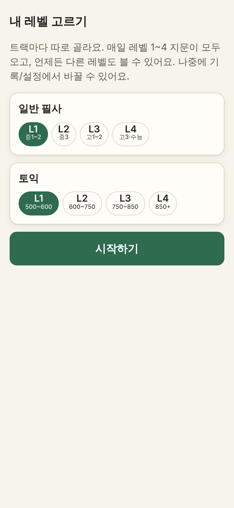 | 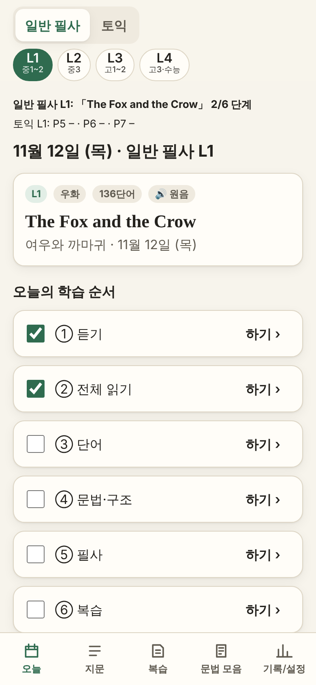 | 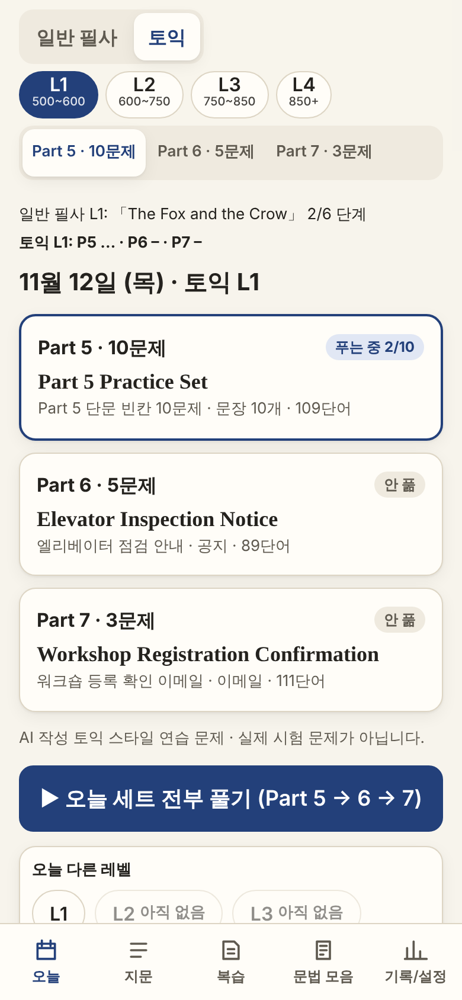 | 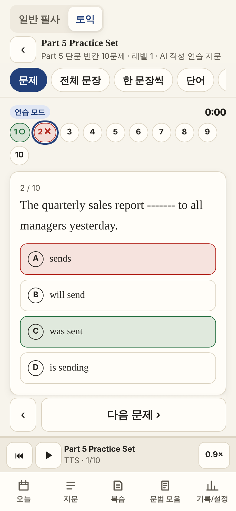 | 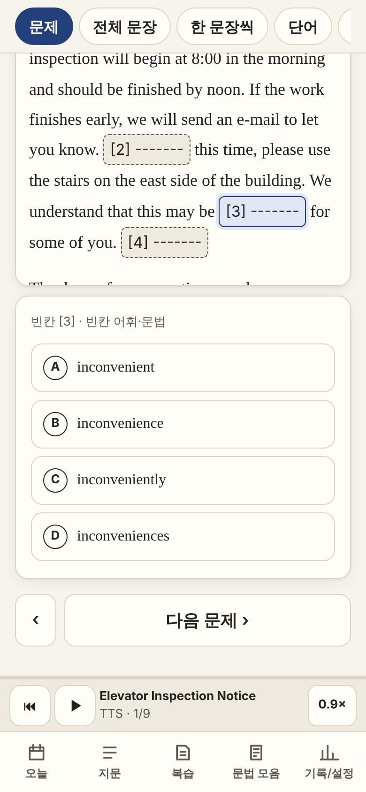 |
| **Part 7 채점 결과** | **오답노트** | **전체 문장** | **플래시카드** | **문장+문법** |
| 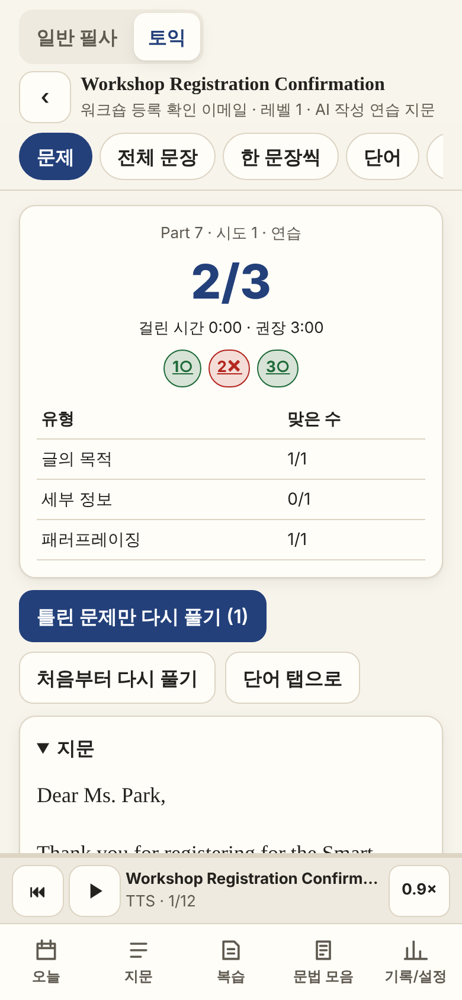 | 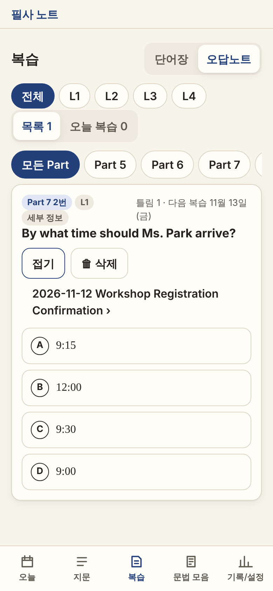 | 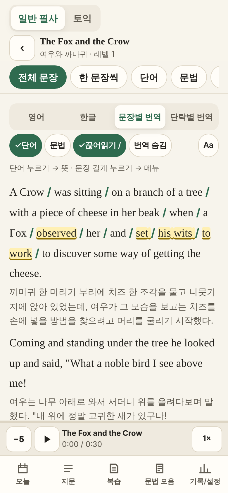 | 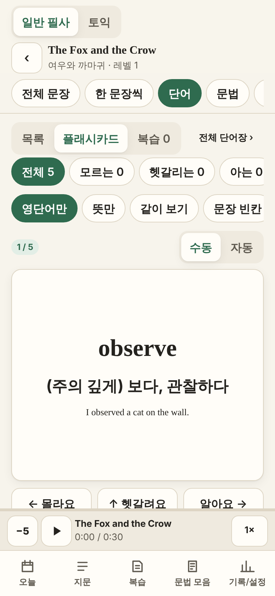 | 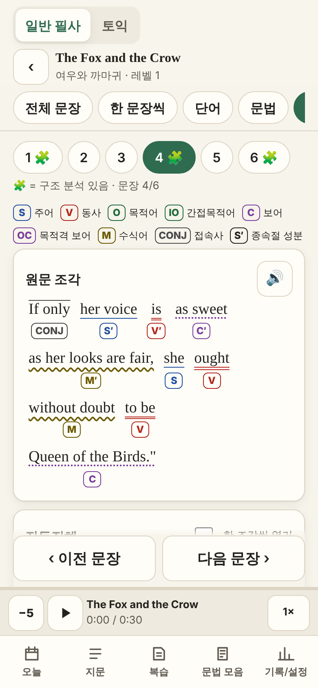 |
| **듣기(원음)** | **듣기(토익 TTS)** | **타이핑 필사** | **토익 지문 목록** | |
| 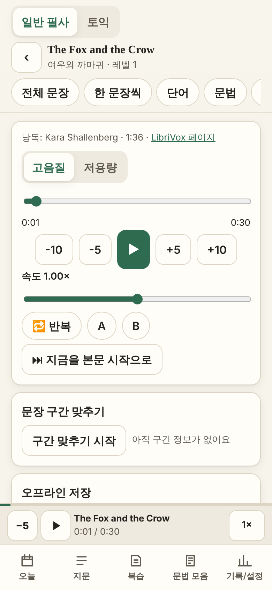 | 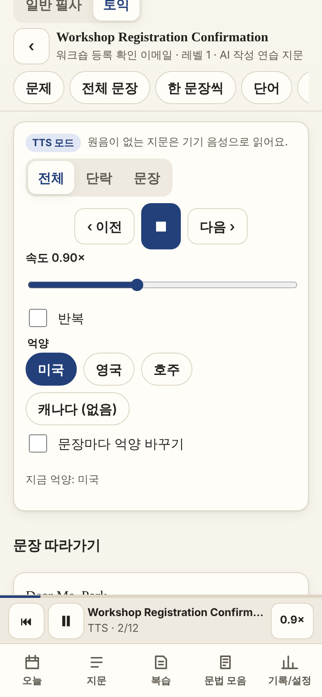 | 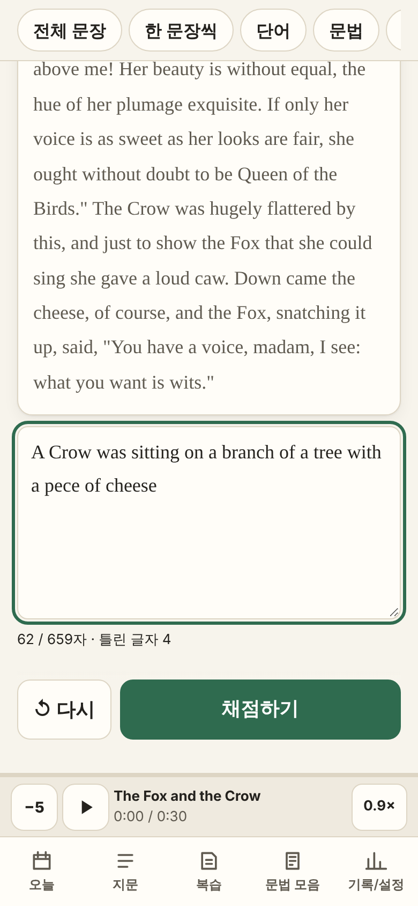 | 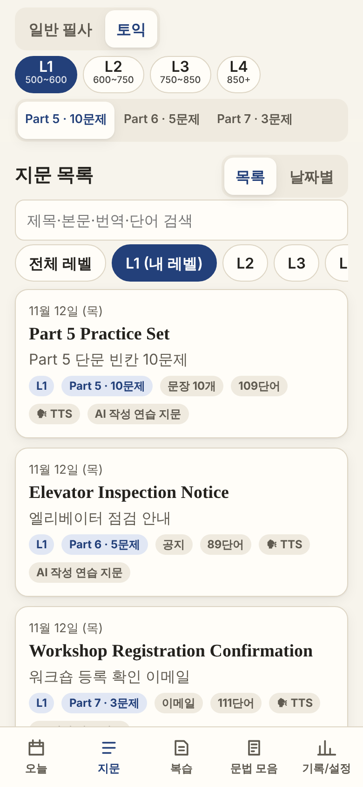 | |

(390×844 캡처. 음원·TTS는 캡처할 때 테스트용 가짜로 바꿨습니다.)

## 로컬 실행

```bash
pip install jsonschema   # 레슨 검증 스크립트에 필요
npm ci
npm run dev          # 먼저 레슨을 검증해서 public/lessons/index.json 을 만든 다음 개발 서버를 켭니다
npm test             # 단위 테스트(Vitest)
npm run e2e          # E2E(Playwright: 390×844·1280×800 × 라이트·다크) — 빌드 후 preview 서버를 띄움
npm run build        # 타입 검사 + 프로덕션 빌드(dist/)
```

- 개발 서버의 `predev` 는 레슨을 검증해 `index.json` 을 만듭니다. 잘못된 레슨이 있으면 오류 목록을 보여 주고 `index.json` 은 갱신하지 않습니다(서버는 켜짐).
- `scripts/make_broken_fixtures.py`: 샘플을 바꾸면 다시 실행해 `tests/fixtures/broken/`(깨진 레슨 묶음)을 새로 만드세요.
- `index.json` 은 CI가 만들기 때문에 저장소에 커밋하지 않습니다(`.gitignore`).
- 화면 캡처 다시 찍기: `SCREENSHOTS=1 npx playwright test e2e/screenshots.spec.ts --project=mobile-light` → `docs/screenshots/`
- 아이콘을 바꿨을 때: `node scripts/make-icons.mjs` (public/icon.svg → PNG)

## 배포 (GitHub Pages)

1. 저장소 **Settings → Pages → Build and deployment → Source: GitHub Actions** 로 한 번 설정합니다.
2. `main` 에 push 하면 `.github/workflows/deploy.yml` 이 실행됩니다.
   `python scripts/validate_lessons.py public/lessons --write-index public/lessons/index.json` → **실패하면 배포 중단** → `npm ci && npm test && npm run build` → Pages 배포.
3. 주소: `https://<사용자명>.github.io/<저장소명>/` (예: `https://simssnim.github.io/SimSs/`). `base: './'` + HashRouter라서 저장소 이름이 바뀌어도 그대로 동작하고, 새로고침해도 404가 나지 않습니다.

## 레슨 추가 방법 (파일 하나 커밋하면 끝)

파일을 하나 추가해서 `main` 에 push 하세요(예약 작업이 매일 자동으로 올립니다).

예약 작업 프롬프트는 [`prompts/general_daily.md`](prompts/general_daily.md)(이야기, 레벨당 `레벨당 이야기 수` 편), [`prompts/news_daily.md`](prompts/news_daily.md)(뉴스)와 [`prompts/toeic_daily.md`](prompts/toeic_daily.md)(토익 Part 5·6·7)입니다. 작업은 4개로 나눠 첫 줄만 `처리할 레벨: 1, 2` / `처리할 레벨: 3, 4` 로 바꿔 씁니다. 저장소 `SimSsNim/SimSs` 를 연결해야 레슨이 자동으로 올라갑니다.

```
public/lessons/general/2026-11-13-L1.json          # 이야기 L1 1편 (L1~L4)
public/lessons/general/2026-11-13-L1-2.json        # 이야기 L1 2편 (-3 … -9)
public/lessons/general/2026-11-13-L3-news.json     # 뉴스 (genre=news, 같은 날 더 있으면 -news2 …)
public/lessons/toeic/2026-11-13-L1-part5.json      # 토익 L1 Part 5 (10문제)
public/lessons/toeic/2026-11-13-L1-part6.json      # 토익 L1 Part 6 (5문제)
public/lessons/toeic/2026-11-13-L1-part7.json      # 토익 L1 Part 7 (3문제)
```

- 파일 이름(확장자 제외) = `id`, 폴더 이름 = `track`. 레슨의 고유 키는 `${track}/${id}` 입니다.
- 하루에 일반 4 + 토익 12 = 16개까지 들어올 수 있고, 일부 레벨·Part가 빠져도 정상 동작합니다(없는 레벨은 "아직 없음").
- 앱은 시작할 때, 자정(KST)이 지났을 때, 다시 화면에 돌아왔을 때 `index.json` 을 다시 받아 새 지문을 찾고, 트랙 전환 버튼에 **빨간 점**으로 알려 줍니다.
- 자동 갱신이 안 될 때는 **기록/설정 → 레슨 가져오기**에서 JSON 파일 여러 개를 한 번에 넣을 수 있습니다("16개 중 15개 추가, 1개 오류(이유)" 식으로 요약). 같은 키가 저장소에도 생기면 저장소 것을 씁니다.

## 레슨 형식 (schemaVersion 2)

기준은 [`lesson.schema.json`](lesson.schema.json) 과 [`scripts/validate_lessons.py`](scripts/validate_lessons.py)(필요: `pip install jsonschema`) 입니다.
앱의 `src/lib/validateLesson.ts` 는 **스키마 파일을 직접 읽어** 같은 JSON 스키마 검사를 하고, 파이썬의 `check()` 규칙을 그대로 옮겼습니다.
`tests/validate.test.ts` 가 정상 샘플 4개와 깨진 레슨 12종(`tests/fixtures/broken/`)을 **TS와 파이썬 양쪽에 넣어 결과가 같은지** 확인합니다(CI에서도 실행).

```jsonc
{
  "schemaVersion": 2, "track": "toeic", "chapter": "part5",          // chapter: 토익만(part5|part6|part7)
  "id": "2026-11-12-L1-part5", "date": "2026-11-12", "level": 1,      // general id = 날짜-L레벨
  "title": "…", "titleKo": "…", "genre": "sentences", "tags": ["…"],  // Part 5 = sentences
  "source": { "work": "…", "author": "…", "translator": null, "year": 2026, "edition": "original", "url": null, "license": "original", "excerptNote": null },
  "audio": null,                                                       // general: { mp3, mp3Low, pageUrl, reader, durationSec, startSec, endSec, note }
  "wordCount": 109,
  "paragraphs": [ { "id": "p1", "sentenceIds": ["s1"], "ko": "…" } ],
  "sentences":  [ { "id": "s1", "paragraphId": "p1", "en": "정답이 들어간 완성 문장", "ko": "…" } ],
  "vocab": [ { "id": "v1", "term": "…", "pos": "noun", "meaningKo": "…", "synonyms": ["…"], "matchText": "…", "sentenceId": "s1", "example": { "en": "…", "ko": "…" } } ],
  "structures": [ { "id": "st1", "sentenceId": "s7", "chunks": [ { "text": "…", "role": "S|V|O|IO|C|OC|M|CONJ", "sub": false, "ko": "…" } ], "skeleton": "…", "explanation": "…" } ],
  "grammar": [ { "id": "g1", "title": "…", "tags": ["품사"], "sentenceId": "s5", "highlight": ["…"], "explanation": "…", "example": { "en": "…", "ko": "…" }, "note": "…" } ],
  "questions": [ {                                                     // 토익만: part5 10개, part6 5개, part7 3개
    "id": "q1", "number": 1, "type": "part5-word-form", "prompt": null,  // Part 7 은 prompt = 질문
    "blank": { "sentenceId": "s1", "answerText": "easy" },             // Part 5·6: 문장 속 answerText(정확히 1번) → "-------"
    "evidenceSentenceIds": ["s2"],                                     // Part 7: 근거 문장
    "choices": [ { "key": "A", "text": "ease" }, { "key": "B", "text": "easy" }, { "key": "C", "text": "easily" }, { "key": "D", "text": "easiness" } ],
    "answer": "B", "explanationKo": "…", "choiceNotesKo": { "A": "…" }, "skill": "형용사 자리"
  } ]
}
```

주요 검증 규칙(파이썬·TS 동일):

- 문단 `sentenceIds` 순서 = `sentences` 순서, `paragraphId` 일치, 문장 앞뒤 공백·이중 공백 없음, `wordCount` 일치, 레벨·Part별 단어 수 범위(±15).
- `chunks[].text` 를 공백 하나로 이으면 문장 `en`, `matchText`·`highlight` 는 그 문장 안에 있음. id 중복 없음.
- `id` = `날짜-L레벨(-part)`, 파일 이름 = id, 폴더 = track. 일반은 퍼블릭 도메인(원문 링크 필수), 토익은 `original` + `audio: null` + 단어마다 `synonyms` 1~3개.
- 토익 문제: 개수(10/5/3), 번호 1부터, 보기 A~D 순서·중복 없음, 정답 보기 = `answerText`, `answerText` 가 문장에 정확히 한 번, Part 5는 문장 10개·문장마다 문제 하나, Part 6은 문장 넣기 정확히 1개(`answerText` = 문장 전체)·문제 순서 = 빈칸 순서, Part 7은 질문과 근거 문장 필수, 정답이 한 보기에 몰리지 않음.

앱은 원본을 화면용 형태로 한 번만 바꿉니다(`src/lib/lessonAdapter.ts`: 문단 원문 = 문장 잇기, `explanation` → 설명 등). 원문·정답·해설은 그대로입니다.

### 예전(v1) 기록 옮기기
IndexedDB 버전 2로 올라갈 때 예전 키를 옮깁니다: `general/2026-11-12` → `general/2026-11-12-L1`, `toeic/2026-11-12` → `toeic/2026-11-12-L1-part7`(진행 체크·북마크·메모·문법 체크·음원 구간·연습 기록·학습 일지·단어 출처·마지막 위치). 예전 형식 레슨 사본은 지우고 다시 받습니다. 버전 1 백업 파일을 가져올 때도 같은 변환을 합니다(`src/lib/migrate.ts`).

## 백업 방법

학습 기록은 브라우저 저장소에만 있으므로 가끔 파일로 내보내 두세요.

- **기록/설정 → 백업 → 백업 파일 내보내기**: `pilsa-backup-YYYY-MM-DD.json` (버전 2, 문제 풀이 시도·오답노트 포함, 가져온 레슨도 포함, 녹음은 제외). 버전 1 백업도 가져올 수 있습니다.
- **백업 파일 가져오기**: `합치기`(같은 단어는 더 최근 기록) 또는 `덮어쓰기`(지금 기록을 지우고 바꿈) 선택
- 마지막 백업 후 14일이 지나면 홈에서 한 번 알려 줍니다.
- iPhone Safari는 홈 화면에 설치하지 않으면 오래 안 쓴 사이트 데이터를 지울 수 있습니다. 첫 실행 때 안내가 나옵니다.

## 구조

```
lesson.schema.json            데이터 계약
scripts/validate_lessons.py   레슨 검증 + index.json 생성(표준 라이브러리만)
public/lessons/<track>/*.json 레슨(샘플 2개)
src/lib/                      타입, validateLesson, Dexie DB, Leitner, 텍스트 비교, TTS, 백업, 레슨 로더
src/store/player.ts           앱 전체에 하나뿐인 오디오 요소 + TTS 재생 상태(탭을 바꿔도 재생 유지)
src/pages/                    홈, 지문 목록, 단어장, 문법 모음, 기록/설정
src/pages/lesson/             레슨 화면과 탭(문제 탭 포함, 트랙·레벨·Part를 인자로 받는 한 벌의 컴포넌트)
src/pages/Review.tsx          복습 탭(단어장 | 오답노트), 약점 유형 모아 풀기
src/lib/quiz.ts, stats.ts     채점·시도 기록·오답노트, 첫 시도 기준 통계
tests/                        Vitest 단위 테스트
e2e/                          Playwright E2E(+ TTS·음원 모킹, 화면 캡처)
```

IndexedDB 테이블(Dexie, `version(2)`): `settings`(+`levelByTrack`, `toeicChapter`, `quizMode`), `lessonCache`, `wordState`(두 트랙 공유), `myWords`, `lessonProgress`, `sentenceMarks`, `grammarState`, `audioMarks`, `practiceLog`(퀴즈는 `kind: 'quiz'`), `dailyLog`, `recordings`(섀도잉, 레슨당 최근 3개), `quizAttempt`(시도 1, 2, …), `questionState`(오답노트·복습 일정), `dismissedTips`(레벨 추천 카드). 스키마를 바꾸면 `version(2).upgrade(...)` 를 추가하고 `DB_VERSION` 을 올리세요. 백업 파일에도 같은 버전이 적힙니다.

## 테스트 결과

```
$ npm test          # Vitest
 Test Files  6 passed (6)
      Tests  60 passed (60)
   - validateLesson v2: 샘플 4개 통과, 깨진 레슨 12종 TS·파이썬 모두 실패(정답≠answerText, answerText 0번/2번, Part 5 9문제,
     Part 6 문장 넣기 0개, Part 6 순서, Part 7 근거 없음, 토익 audio, 폴더≠track, id 형식, chunks, wordCount)
   - 빈칸 만들기(Part 5 q1, Part 6 q4), 채점·첫 시도 기준 통계, 오답 졸업 일정(KST), 마이그레이션 키 변환,
     Dexie v1→v2 업그레이드, 백업 v1→v2, Leitner, 타이핑 비교, 백업 왕복

$ npm run e2e       # Playwright: mobile-light, mobile-dark, desktop-light, desktop-dark
  85 passed, 7 skipped  (오프라인은 mobile-light 한 곳, 캡처 스펙은 SCREENSHOTS=1 일 때만)
```

Lighthouse 12(모바일, 로컬 preview): 성능 91–97, 접근성 100(토익 오늘·Part 5·Part 6 문제·오답노트·홈·전체 문장·문장+문법·토익 듣기·기록·설정).
역할 색·하이라이트 색은 라이트·다크 모두 배경 대비 4.5:1 이상.

## 단계별 ✅ 확인표

자동 = 단위/E2E 테스트로 확인, 캡처 = 390px 화면을 직접 보고 확인, 수동 = 실제 기기에서 확인 필요(아래 체크리스트).

### (v1) 1단계 — 뼈대와 데이터
| 항목 | 확인 |
|---|---|
| 저장소 구조, 타입, `validateLesson.ts` = 파이썬과 같은 규칙 | ✅ 자동 (샘플 통과 + 깨진 샘플 9종 실패) |
| 레슨 로더(index network-first, 본문 캐시, 오프라인 대비 IndexedDB 사본) | ✅ 자동 (E2E 7) |
| 라우팅 `/:track/lesson/:id/:tab`, HashRouter | ✅ 자동 |
| 트랙 전환·하단 탭 5개, 트랙별 색 포인트, 트랙별 마지막 위치 | ✅ 자동 (E2E 1-1) + 캡처 |
| PWA(manifest, 서비스 워커, 업데이트 토스트는 수동 새로고침) | ✅ 자동 (E2E 7) |
| GitHub Actions(검증 실패 시 배포 중단) | ✅ 로컬에서 같은 명령 실행 확인 / ⬜ 실제 Actions 실행은 `main` 반영 후 |
| 두 샘플로 두 트랙의 홈·지문 목록 표시, 모든 화면이 track 인자 하나로 동작 | ✅ 자동 + 캡처 |

### 2단계 — 읽기와 듣기
| 항목 | 확인 |
|---|---|
| 전체 문장: 화면 영어 = 원문(두 트랙, 끊어 읽기 표시 켠 상태 포함) | ✅ 자동 (E2E 1) |
| 표시 모드 4종, 단어/문법 하이라이트, `/` 끊어 읽기, 번역 가리기, 글자 4단계·줄 간격·세리프 | ✅ 캡처 |
| 단어 탭 팝업(뜻·예문 / TTS·내 단어 추가), 문장 길게 누르기 메뉴 | ✅ 캡처 |
| 한 문장씩: 6번 넘기면 마지막 카드, ←/→, 자동 넘김 | ✅ 자동 (E2E 2) |
| 듣기(원음): 컨트롤, 0.5~1.5 속도, 반복, A-B, 구간 맞추기 + 미세 조정 + 내보내기, 본문 시작 위치 | ✅ 자동 (모킹 음원) |
| 탭을 바꿔도 재생 유지(전역 오디오 하나), `preservesPitch` | ✅ 자동 |
| 토익 듣기: TTS 모드, 문장 강조 따라감, 억양 4종(없는 억양 회색), 문장마다 억양 바꾸기 | ✅ 자동 (E2E 1-2, TTS 모킹) |
| 잠금 화면 컨트롤(Media Session), 음원 오프라인 저장 | ⬜ 수동 (archive.org가 이 개발 환경에서 막혀 있어 실제 저장은 미확인. 실패하면 버튼을 숨기고 "온라인에서만 재생" 안내) |

### 3단계 — 단어
| 항목 | 확인 |
|---|---|
| 목록: 상태 4가지 + ★, [알아요]/[몰라요], 필터 칩 개수 즉시 반영 | ✅ 자동 (E2E 4) |
| 새로고침 후 상태 유지 | ✅ 자동 (E2E 4) |
| 플래시카드: 표시 모드 4종, 수동/자동(1~10초, 0.5초 단위), 2단계, TTS 옵션, 반복, 순서/랜덤 | ✅ 자동 (E2E 3) + 캡처 |
| 자동 넘김 2초 · 일시정지 · 다른 탭으로 가면 타이머 정리 · 백그라운드면 일시정지 | ✅ 자동 (E2E 3) |
| 스와이프 분류(→ 알아요, ← 몰라요, ↑ 헷갈려요) + 버튼 + 키보드 1/2/3 | ✅ 구현(버튼 경로는 자동 확인) |
| 단어장: term 기준 합치기 + 출처 레슨, 내 단어 포함, 검색·정렬·레벨·날짜 범위 | ✅ 캡처 |
| Leitner 5칸(1·2·4·7·15일, KST 날짜 경계), 오늘 복습 | ✅ 자동 (단위 테스트) |

### 4단계 — 문법과 구조
| 항목 | 확인 |
|---|---|
| 문법 카드, 문장으로 이동, 예문 TTS, [이해함]/[다시 볼래요] | ✅ 캡처 |
| 미니 퀴즈(highlight 빈칸, 대소문자·앞뒤 공백 무시) | ✅ 자동 (단위 테스트 `answerEq`) |
| 문법 모음: 태그별 개수, "다시 볼래요"만 | ✅ 캡처 |
| 문장+문법: 역할 라벨 순서, `S′`, 색 + 밑줄 모양(색약 대비), 범례, 직독직해·한 조각씩, 뼈대만 보기 | ✅ 자동 (E2E 5) + 캡처 |
| 조각을 이으면 원문 문장 | ✅ 자동 (검증 + E2E 5) |

### 5단계 — 필사·연습
| 항목 | 확인 |
|---|---|
| 종이 필사(Wake Lock, 타이머, 완료 → 체크리스트) | ✅ 구현 / ⬜ 화면 꺼짐 방지는 기기에서 수동 |
| 타이핑 필사: 그대로 입력 100%, 한 글자 틀리면 100% 미만, 따옴표 같게, 엄격도, WPM, 틀린 단어 → 내 단어 | ✅ 자동 (E2E 6, 단위 테스트) |
| 받아쓰기, 빈칸(보기/입력), 문장 배열(탭·끌어 놓기, 맞히면 역할 공개), 해석 연습(자기 평가) | ✅ 캡처 + 가로 스크롤 검사 |
| 섀도잉(MediaRecorder 지원 시만, 레슨당 최근 3개) | ⬜ 마이크가 필요해 수동 |
| 모든 연습 결과를 practiceLog에 기록 | ✅ 자동 (백업 왕복 테스트에 포함) |

### 6단계 — 기록·설정·마무리
| 항목 | 확인 |
|---|---|
| 잔디 캘린더(날짜 누르면 그날 한 일), 완료 레슨 수, 아는 단어 추이, 정확도 추이(SVG) | ✅ 캡처 |
| 설정(테마, 글자, 표시 모드, TTS 음성·속도·억양, 자동 넘김, 음질, 타이핑 엄격도, 하루 목표) | ✅ 캡처 |
| 백업/복원(합치기·덮어쓰기), 14일 알림 | ✅ 자동 (내보내기 → 가져오기 왕복이 같은 데이터) |
| 레슨 가져오기: 깨진 JSON → 오류, 정상 → 목록에 "가져옴" | ✅ 자동 (E2E 8) |
| 데이터 초기화(두 번 확인) | ✅ 구현 |
| 다크 모드, 대비 4.5:1, 가로 스크롤 없음(모든 화면, 390·1280) | ✅ 자동 (E2E 9 × 4 프로젝트) + 대비 계산 |
| 접근성(터치 44px, 키보드, 색 + 글자 라벨, reduced-motion) · 성능 | ✅ Lighthouse 접근성 100 / 성능 96–97 |

### v2 A단계 — 데이터·마이그레이션
| 항목 | 확인 |
|---|---|
| 새 스키마·검증 스크립트·샘플 4개 적용, 예전 샘플 삭제 | ✅ |
| 타입(`src/lib/types.ts`), `validateLesson.ts` = 파이썬과 같은 결과 | ✅ 자동 (같은 파일로 양쪽 실행) |
| 로더: index v2, track → level → date → chapter 묶기, 오늘 없으면 최근 날짜 | ✅ 자동 |
| Dexie v2 마이그레이션, 새 테이블(quizAttempt·questionState·dismissedTips) | ✅ 자동 (v1 DB를 만들어 업그레이드) |
| 새 샘플 4개로 목록 표시 | ✅ 자동 + 캡처 |

### v2 B단계 — 레벨·챕터 선택
| 항목 | 확인 |
|---|---|
| 상단 레벨 칩(설명 포함), 트랙마다 따로 기억, 처음 실행 레벨 고르기 | ✅ 자동 (E2E v1) + 캡처 |
| 오늘 다른 레벨(없으면 "아직 없음"), 앱이 죽지 않음 | ✅ 자동 (E2E v2) |
| 지문 목록 레벨 필터(기본 내 레벨·전체), 날짜별 보기 | ✅ 자동 + 캡처 |
| Part 세그먼트, 토익 Part 카드 3장(상태·시간), 오늘 세트 전부 풀기 | ✅ 자동 (E2E v3·v6) + 캡처 |
| 단어장·문법 모음·오답노트·기록 레벨 필터 | ✅ 캡처 |

### v2 C단계 — 문제 탭
| 항목 | 확인 |
|---|---|
| 연습 모드(바로 채점·해설·헷갈렸어요), 실전 모드(타이머·초과 표시·한꺼번에 채점) | ✅ 자동 (E2E v3·v5·v6) |
| Part 5 카드·진행 점·스와이프, Part 6 빈칸 번호↔문제 연결·채우기, Part 7 지문\|문제 탭(데스크톱 2단)·근거 보기 | ✅ 자동 (E2E v3·v4·v5) + 캡처 |
| 키보드 1~4·A~D·←/→·Enter | ✅ 구현 |
| 채점 결과(점수·시간·문항별 ○/×·유형별·해설·보기별 메모·완성 문장·관련 단어/문법), 틀린 문제만 다시, 이 문장 필사하기 | ✅ 자동 + 캡처 |
| 시도 기록(시도 2, 3…), 오늘 화면·통계는 첫 시도 기준 | ✅ 자동 (단위 + E2E v3) |
| 이어 풀기(답·남은 시간 저장), 실전 모드 다른 탭 가리기 + [그냥 보기], 연습 모드는 푼 문장만 공개 | ✅ 자동 (E2E v6) |

### v2 D단계 — 복습·통계
| 항목 | 확인 |
|---|---|
| 하단 탭 `오늘 · 지문 · 복습 · 문법 모음 · 기록/설정`, 복습 = 단어장 \| 오답노트 | ✅ |
| 틀린 문제 자동 등록, 헷갈렸어요 등록, Part·레벨·유형·날짜 필터, 정렬 | ✅ 자동 (E2E v3·v7) + 캡처 |
| 보기 섞어 다시 풀기, 1일 → 3일 → 졸업(같은 복습 엔진 `leitner.ts`) | ✅ 자동 (단위 + E2E v7) |
| Part·유형·레벨별 정답률, 평균 시간 vs 권장, 이번 주 약점 3개 → 모아 풀기 | ✅ 자동 (E2E v8) |
| 레벨 추천 카드(제안만, 닫으면 7일) | ✅ 구현 |

### v2 E단계 — 마무리
| 항목 | 확인 |
|---|---|
| 백업 v2(새 테이블 포함), v1 백업 가져오기 | ✅ 자동 |
| 레슨 여러 파일 가져오기 + 요약 | ✅ 자동 (E2E 8) |
| 다크 모드·접근성·390px(가로 스크롤 없음, 새 화면 포함) | ✅ 자동 (E2E 9 × 4 프로젝트) + Lighthouse |

## 수동 확인 체크리스트

- [ ] iPhone Safari: 공유 → 홈 화면에 추가 → 설치된 앱으로 열림
- [ ] iPhone: 일반 레슨 음원 재생, 잠금 화면에 제목과 재생/정지·앞뒤 이동 컨트롤 표시
- [ ] iPhone: 화면을 끄면 재생이 멈출 수 있음(알려진 제약) — 안내 문구 확인
- [ ] Android Chrome: "앱 설치" → 설치 후 오프라인으로 열기
- [ ] 기기에 영어 TTS 음성이 있는지(설정 → 음성(TTS)에 억양 버튼이 켜져 있는지). 없으면 TTS 버튼이 숨겨짐
- [ ] 토익 듣기에서 미국·영국·호주·캐나다 억양이 실제로 다르게 들리는지(기기에 있는 것만)
- [ ] 토익 실전 모드: 앱을 닫았다 열어도 고른 답과 남은 시간이 이어지는지
- [ ] archive.org 음원 "이 음원 저장" 이 실제로 되는지(안 되면 "온라인에서만 재생" 안내가 나와야 함)
- [ ] 샘플 일반 레슨의 음원(`public/lessons/general/2026-11-12-L1.json` 의 `audio.mp3`, LibriVox Vol.01 #09)이 실제로 재생되는지 — 개발 환경에서는 archive.org 접속이 막혀 확인하지 못했습니다.
- [ ] 종이 필사 중 화면이 꺼지지 않는지(Wake Lock)
- [ ] 섀도잉 녹음 → 내 녹음 듣기 → 번갈아 듣기

## 알려진 제약과 처리

- **iOS Safari**: 설치하지 않으면 데이터가 지워질 수 있음 → 첫 실행 안내 + 14일 백업 알림. 백그라운드 오디오가 끊길 수 있음 → 안내만.
- **음성 인식**은 쓰지 않음(섀도잉은 녹음·비교 듣기만).
- **TTS 음성**은 기기마다 다름 → `en-*` 음성이 없으면 TTS 버튼을 숨김, `voiceschanged` 처리.
- **archive.org**: `<audio>` 재생은 CORS 불필요. 오프라인 저장은 CORS가 필요하므로 실제로 받아 보고 실패하면 버튼을 숨김. 파형 표시는 없음.
- 레슨 원문은 절대 바꾸지 않음(따옴표 모양 포함). 앱에 외부 AI 호출·분석·광고·외부 폰트 없음(시스템 폰트).
- 앱 안 표기는 "토익 스타일 연습"·"AI 작성 연습 지문"까지. ETS 기출·로고·상표 디자인 없음. 아이콘은 직접 만든 SVG.
