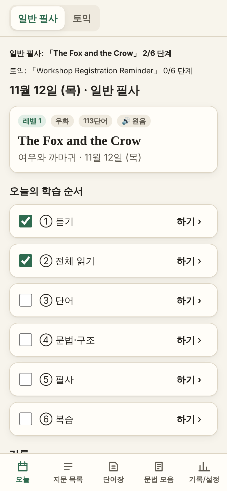
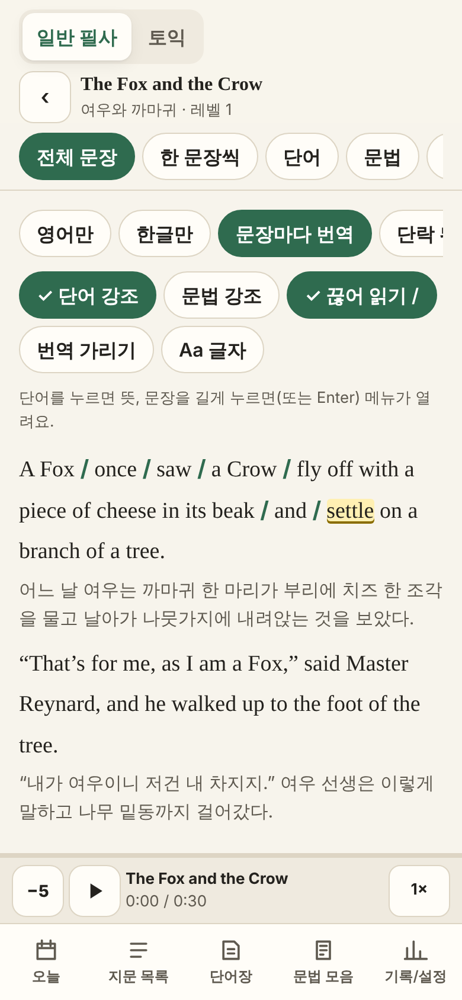
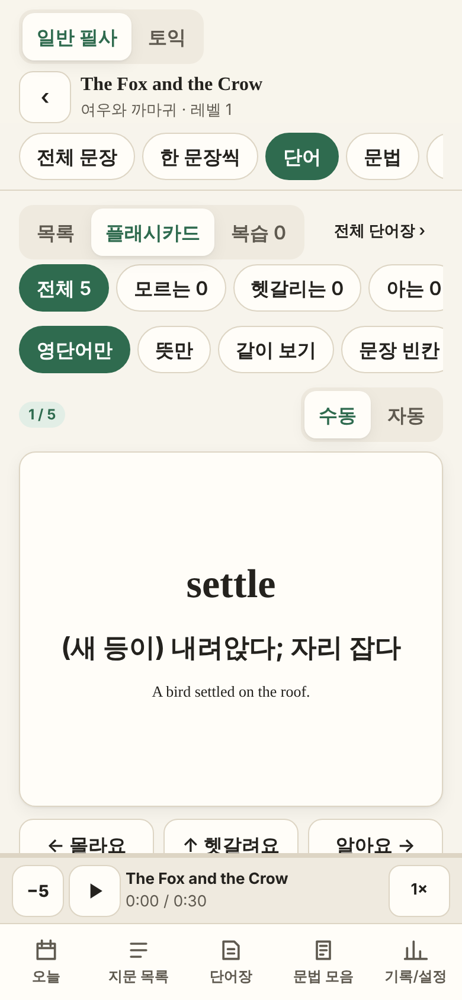
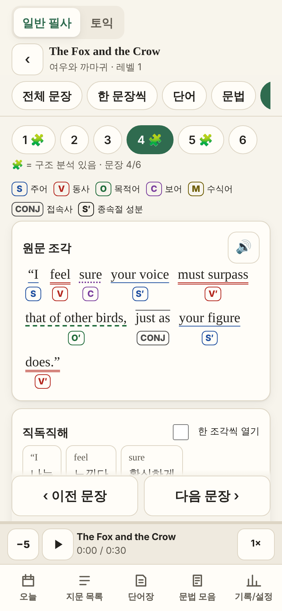
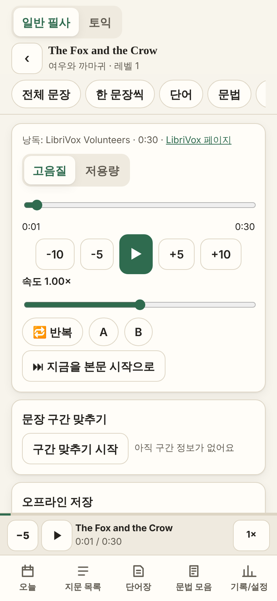
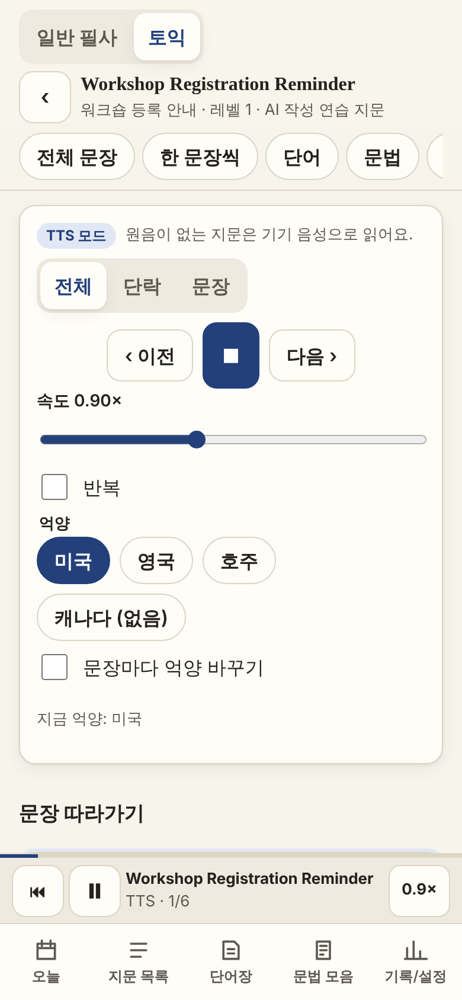
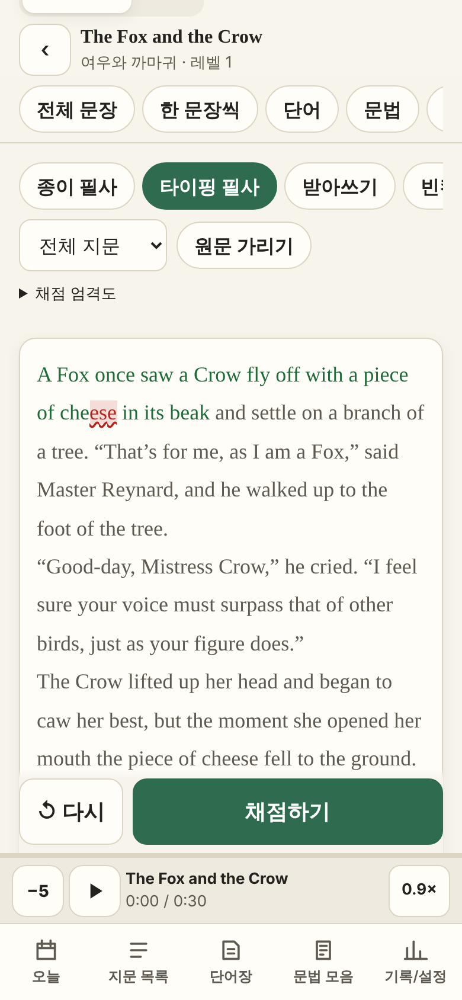
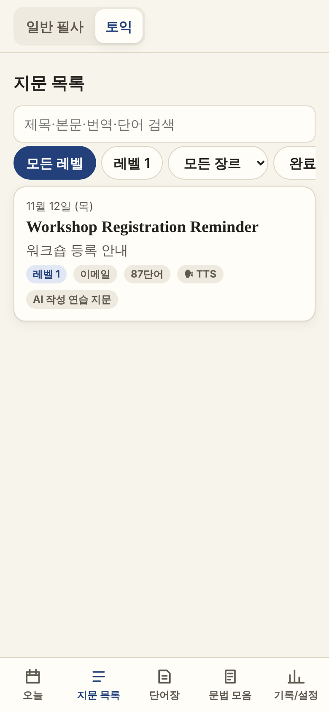

# 필사 노트 — 영어 필사 학습 PWA (일반 필사 + 토익 스타일 연습)

한국인 영어 학습자 1명을 위한 **개인용 영어 필사 학습 앱**입니다. 서버·로그인 없이 GitHub Pages에서 돌아가고, 홈 화면에 설치하면 오프라인에서도 쓸 수 있습니다.

- **일반 필사** (`general`): 퍼블릭 도메인 고전 + LibriVox 낭독 음원
- **토익** (`toeic`): 토익 Part 6·7 스타일로 새로 쓴 **AI 작성 연습 지문** (실제 시험 지문 아님, 음원 없음 → 브라우저 TTS)
- 두 트랙은 **같은 화면·같은 컴포넌트**를 쓰고 데이터만 다릅니다. 학습 기록은 전부 기기 안(IndexedDB)에 저장됩니다.

| 홈 | 전체 문장 | 플래시카드 | 문장+문법 |
|---|---|---|---|
|  |  |  |  |
| **듣기(원음)** | **듣기(토익 TTS)** | **타이핑 필사** | **토익 지문 목록** |
|  |  |  |  |

(390×844 캡처. 음원·TTS는 캡처할 때 테스트용 가짜로 바꿨습니다.)

## 로컬 실행

```bash
npm ci
npm run dev          # 먼저 레슨을 검증해서 public/lessons/index.json 을 만든 다음 개발 서버를 켭니다
npm test             # 단위 테스트(Vitest)
npm run e2e          # E2E(Playwright: 390×844·1280×800 × 라이트·다크) — 빌드 후 preview 서버를 띄움
npm run build        # 타입 검사 + 프로덕션 빌드(dist/)
```

- 개발 서버의 `predev` 는 `--keep-going` 으로 실행되므로, 잘못된 레슨이 있어도 서버는 켜지고 목록에 **오류** 배지로 보입니다.
- `index.json` 은 CI가 만들기 때문에 저장소에 커밋하지 않습니다(`.gitignore`).
- 화면 캡처 다시 찍기: `SCREENSHOTS=1 npx playwright test e2e/screenshots.spec.ts --project=mobile-light` → `docs/screenshots/`
- 아이콘을 바꿨을 때: `node scripts/make-icons.mjs` (public/icon.svg → PNG)

## 배포 (GitHub Pages)

1. 저장소 **Settings → Pages → Build and deployment → Source: GitHub Actions** 로 한 번 설정합니다.
2. `main` 에 push 하면 `.github/workflows/deploy.yml` 이 실행됩니다.
   `python scripts/validate_lessons.py public/lessons --write-index public/lessons/index.json` → **실패하면 배포 중단** → `npm ci && npm test && npm run build` → Pages 배포.
3. 주소: `https://<사용자명>.github.io/<저장소명>/` (예: `https://simssnim.github.io/SimSs/`). `base: './'` + HashRouter라서 저장소 이름이 바뀌어도 그대로 동작하고, 새로고침해도 404가 나지 않습니다.

## 레슨 추가 방법 (파일 하나 커밋하면 끝)

`public/lessons/<track>/<YYYY-MM-DD>.json` 파일을 하나 추가해서 `main` 에 push 하세요.

```
public/lessons/general/2026-11-13.json   # 일반 필사
public/lessons/toeic/2026-11-13.json     # 토익
```

- 파일 이름(확장자 제외) = `id`, 폴더 이름 = `track`.
- 같은 날짜에 두 트랙 레슨이 같이 있어도 됩니다. 레슨의 고유 키는 `${track}/${id}` 입니다.
- 하루 빠지거나 하루에 두 개가 와도 정상 동작합니다(날짜가 키).
- 앱은 시작할 때, 자정(KST)이 지났을 때, 다시 화면에 돌아왔을 때 `index.json` 을 다시 받아 새 지문을 찾고, 트랙 전환 버튼에 **빨간 점**으로 알려 줍니다.
- 자동 갱신이 안 될 때는 **기록/설정 → 레슨 가져오기**에서 JSON 파일(여러 개 가능)이나 텍스트를 붙여넣어 넣을 수 있습니다. 같은 키가 저장소에도 생기면 저장소 것을 씁니다.

## 데이터 형식 요약

기준은 [`lesson.schema.json`](lesson.schema.json) 입니다. TypeScript 타입은 `src/lib/types.ts`, 검증은 `scripts/validate_lessons.py` 와 `src/lib/validateLesson.ts`(같은 규칙)입니다.

```jsonc
{
  "schemaVersion": 1,
  "id": "2026-11-12", "track": "toeic", "date": "2026-11-12", "level": 1,
  "title": "…", "titleKo": "…", "genre": "email", "genreKo": "이메일",
  "wordCount": 87,                         // 모든 문단 en 을 공백으로 나눈 토큰 수
  "source": { "license": "original", "note": "…" },   // general = public-domain, toeic = original
  "audio": null,                           // general: { mp3, mp3Low, reader, durationSec, librivoxUrl } / toeic: 항상 null
  "paragraphs": [{ "id": "p1", "en": "…", "ko": "…",
    "sentences": [{ "id": "s1", "en": "…", "ko": "…", "audioStartSec": null, "audioEndSec": null }] }],
  "vocab": [{ "id": "v1", "term": "be held", "pos": "phr", "meaningKo": "…", "sentenceId": "s1",
              "matchText": "be held", "example": { "en": "…", "ko": "…" }, "synonyms": ["take place"] }],
  "structures": [{ "sentenceId": "s1", "skeleton": "…", "explanationKo": "…",
    "chunks": [{ "text": "Thank", "role": "V", "ko": "…" }, { "text": "which", "role": "S", "sub": true, "ko": "…" }] }],
  "grammar": [{ "id": "g1", "title": "…", "tags": ["관계사"], "sentenceId": "s1",
                "highlight": ["which will be held"], "explanationKo": "…", "examples": [{ "en": "…", "ko": "…" }], "note": "…" }]
}
```

검증 규칙(파이썬·TS 동일):

- 문단의 문장 `en` 을 공백 하나로 이으면 문단 `en` 과 정확히 같다.
- `structures[].chunks[].text` 를 공백 하나로 이으면 그 문장 `en` 과 정확히 같다(끊어 읽기 `/`, 문장 배열 게임에 그대로 사용).
- `vocab[].matchText`, `grammar[].highlight[]` 는 해당 문장 안에 그대로 있는 문자열이다(첫 일치 위치를 하이라이트).
- `wordCount` 일치, 모든 `sentenceId` 존재, 문장·단어·문법 id 중복 없음, `id` = 파일 이름, `track` = 폴더 이름.
- 일반 트랙은 `public-domain` 만, 토익 트랙은 `original` 만 허용. 토익의 `audio` 는 null.
- 역할 `role`: `S` `V` `O` `C` `M` `CONJ`, 종속절 성분은 `"sub": true` (화면에 `S′` `V′`).

## 백업 방법

학습 기록은 브라우저 저장소에만 있으므로 가끔 파일로 내보내 두세요.

- **기록/설정 → 백업 → 백업 파일 내보내기**: `pilsa-backup-YYYY-MM-DD.json` (버전 필드 포함, 가져온 레슨도 포함, 녹음은 제외)
- **백업 파일 가져오기**: `합치기`(같은 단어는 더 최근 기록) 또는 `덮어쓰기`(지금 기록을 지우고 바꿈) 선택
- 마지막 백업 후 14일이 지나면 홈에서 한 번 알려 줍니다.
- iPhone Safari는 홈 화면에 설치하지 않으면 오래 안 쓴 사이트 데이터를 지울 수 있습니다. 첫 실행 때 안내가 나옵니다.

## 구조

```
lesson.schema.json            데이터 계약
scripts/validate_lessons.py   레슨 검증 + index.json 생성(표준 라이브러리만)
public/lessons/<track>/*.json 레슨(샘플 2개)
src/lib/                      타입, validateLesson, Dexie DB, Leitner, 텍스트 비교, TTS, 백업, 레슨 로더
src/store/player.ts           앱 전체에 하나뿐인 오디오 요소 + TTS 재생 상태(탭을 바꿔도 재생 유지)
src/pages/                    홈, 지문 목록, 단어장, 문법 모음, 기록/설정
src/pages/lesson/             레슨 화면과 7개 탭(트랙을 인자로 받는 한 벌의 컴포넌트)
tests/                        Vitest 단위 테스트
e2e/                          Playwright E2E(+ TTS·음원 모킹, 화면 캡처)
```

IndexedDB 테이블(Dexie, `version(1)`): `settings`, `lessonCache`, `wordState`(두 트랙 공유), `myWords`, `lessonProgress`, `sentenceMarks`, `grammarState`, `audioMarks`, `practiceLog`, `dailyLog`, `recordings`(섀도잉, 레슨당 최근 3개). 스키마를 바꾸면 `version(2).upgrade(...)` 를 추가하고 `DB_VERSION` 을 올리세요. 백업 파일에도 같은 버전이 적힙니다.

## 테스트 결과

```
$ npm test
 Test Files  4 passed (4)
      Tests  31 passed (31)

$ npm run e2e      # 4개 프로젝트: mobile-light, mobile-dark, desktop-light, desktop-dark
  53 passed, 7 skipped   (오프라인 테스트는 mobile-light 한 곳에서만, 캡처 스펙은 SCREENSHOTS=1 일 때만)
```

Lighthouse 12(모바일, 로컬 preview): 성능 96–97, 접근성 100(홈·전체 문장·문장+문법·토익 듣기·단어장·기록·설정), 권장사항 100.
역할 색·하이라이트 색은 라이트·다크 모두 배경 대비 4.5:1 이상(스크립트로 계산해 확인).
Lighthouse 12에는 PWA 점수 항목이 없어서, 설치 가능 조건(manifest 192/512/maskable 아이콘, `display: standalone`, 서비스 워커 + 오프라인 동작)은 manifest 설정과 E2E 7번(오프라인)으로 확인했습니다.

## 단계별 ✅ 확인표

자동 = 단위/E2E 테스트로 확인, 캡처 = 390px 화면을 직접 보고 확인, 수동 = 실제 기기에서 확인 필요(아래 체크리스트).

### 1단계 — 뼈대와 데이터
| 항목 | 확인 |
|---|---|
| 저장소 구조, 타입, `validateLesson.ts` = 파이썬과 같은 규칙 | ✅ 자동 (샘플 통과 + 깨진 샘플 9종 실패) |
| 레슨 로더(index network-first, 본문 캐시, 오프라인 대비 IndexedDB 사본) | ✅ 자동 (E2E 7) |
| 라우팅 `/:track/lesson/:id/:tab`, HashRouter | ✅ 자동 |
| 트랙 전환·하단 탭 5개, 트랙별 색 포인트, 트랙별 마지막 위치 | ✅ 자동 (E2E 1-1) + 캡처 |
| PWA(manifest, 서비스 워커, 업데이트 토스트는 수동 새로고침) | ✅ 자동 (E2E 7) |
| GitHub Actions(검증 실패 시 배포 중단) | ✅ 로컬에서 같은 명령 실행 확인 / ⬜ 실제 Actions 실행은 `main` 반영 후 |
| 두 샘플로 두 트랙의 홈·지문 목록 표시, 모든 화면이 track 인자 하나로 동작 | ✅ 자동 + 캡처 |

### 2단계 — 읽기와 듣기
| 항목 | 확인 |
|---|---|
| 전체 문장: 화면 영어 = 원문(두 트랙, 끊어 읽기 표시 켠 상태 포함) | ✅ 자동 (E2E 1) |
| 표시 모드 4종, 단어/문법 하이라이트, `/` 끊어 읽기, 번역 가리기, 글자 4단계·줄 간격·세리프 | ✅ 캡처 |
| 단어 탭 팝업(뜻·예문 / TTS·내 단어 추가), 문장 길게 누르기 메뉴 | ✅ 캡처 |
| 한 문장씩: 6번 넘기면 마지막 카드, ←/→, 자동 넘김 | ✅ 자동 (E2E 2) |
| 듣기(원음): 컨트롤, 0.5~1.5 속도, 반복, A-B, 구간 맞추기 + 미세 조정 + 내보내기, 본문 시작 위치 | ✅ 자동 (모킹 음원) |
| 탭을 바꿔도 재생 유지(전역 오디오 하나), `preservesPitch` | ✅ 자동 |
| 토익 듣기: TTS 모드, 문장 강조 따라감, 억양 4종(없는 억양 회색), 문장마다 억양 바꾸기 | ✅ 자동 (E2E 1-2, TTS 모킹) |
| 잠금 화면 컨트롤(Media Session), 음원 오프라인 저장 | ⬜ 수동 (archive.org가 이 개발 환경에서 막혀 있어 실제 저장은 미확인. 실패하면 버튼을 숨기고 "온라인에서만 재생" 안내) |

### 3단계 — 단어
| 항목 | 확인 |
|---|---|
| 목록: 상태 4가지 + ★, [알아요]/[몰라요], 필터 칩 개수 즉시 반영 | ✅ 자동 (E2E 4) |
| 새로고침 후 상태 유지 | ✅ 자동 (E2E 4) |
| 플래시카드: 표시 모드 4종, 수동/자동(1~10초, 0.5초 단위), 2단계, TTS 옵션, 반복, 순서/랜덤 | ✅ 자동 (E2E 3) + 캡처 |
| 자동 넘김 2초 · 일시정지 · 다른 탭으로 가면 타이머 정리 · 백그라운드면 일시정지 | ✅ 자동 (E2E 3) |
| 스와이프 분류(→ 알아요, ← 몰라요, ↑ 헷갈려요) + 버튼 + 키보드 1/2/3 | ✅ 구현(버튼 경로는 자동 확인) |
| 단어장: term 기준 합치기 + 출처 레슨, 내 단어 포함, 검색·정렬·레벨·날짜 범위 | ✅ 캡처 |
| Leitner 5칸(1·2·4·7·15일, KST 날짜 경계), 오늘 복습 | ✅ 자동 (단위 테스트) |

### 4단계 — 문법과 구조
| 항목 | 확인 |
|---|---|
| 문법 카드, 문장으로 이동, 예문 TTS, [이해함]/[다시 볼래요] | ✅ 캡처 |
| 미니 퀴즈(highlight 빈칸, 대소문자·앞뒤 공백 무시) | ✅ 자동 (단위 테스트 `answerEq`) |
| 문법 모음: 태그별 개수, "다시 볼래요"만 | ✅ 캡처 |
| 문장+문법: 역할 라벨 순서, `S′`, 색 + 밑줄 모양(색약 대비), 범례, 직독직해·한 조각씩, 뼈대만 보기 | ✅ 자동 (E2E 5) + 캡처 |
| 조각을 이으면 원문 문장 | ✅ 자동 (검증 + E2E 5) |

### 5단계 — 필사·연습
| 항목 | 확인 |
|---|---|
| 종이 필사(Wake Lock, 타이머, 완료 → 체크리스트) | ✅ 구현 / ⬜ 화면 꺼짐 방지는 기기에서 수동 |
| 타이핑 필사: 그대로 입력 100%, 한 글자 틀리면 100% 미만, 따옴표 같게, 엄격도, WPM, 틀린 단어 → 내 단어 | ✅ 자동 (E2E 6, 단위 테스트) |
| 받아쓰기, 빈칸(보기/입력), 문장 배열(탭·끌어 놓기, 맞히면 역할 공개), 해석 연습(자기 평가) | ✅ 캡처 + 가로 스크롤 검사 |
| 섀도잉(MediaRecorder 지원 시만, 레슨당 최근 3개) | ⬜ 마이크가 필요해 수동 |
| 모든 연습 결과를 practiceLog에 기록 | ✅ 자동 (백업 왕복 테스트에 포함) |

### 6단계 — 기록·설정·마무리
| 항목 | 확인 |
|---|---|
| 잔디 캘린더(날짜 누르면 그날 한 일), 완료 레슨 수, 아는 단어 추이, 정확도 추이(SVG) | ✅ 캡처 |
| 설정(테마, 글자, 표시 모드, TTS 음성·속도·억양, 자동 넘김, 음질, 타이핑 엄격도, 하루 목표) | ✅ 캡처 |
| 백업/복원(합치기·덮어쓰기), 14일 알림 | ✅ 자동 (내보내기 → 가져오기 왕복이 같은 데이터) |
| 레슨 가져오기: 깨진 JSON → 오류, 정상 → 목록에 "가져옴" | ✅ 자동 (E2E 8) |
| 데이터 초기화(두 번 확인) | ✅ 구현 |
| 다크 모드, 대비 4.5:1, 가로 스크롤 없음(모든 화면, 390·1280) | ✅ 자동 (E2E 9 × 4 프로젝트) + 대비 계산 |
| 접근성(터치 44px, 키보드, 색 + 글자 라벨, reduced-motion) · 성능 | ✅ Lighthouse 접근성 100 / 성능 96–97 |

## 수동 확인 체크리스트

- [ ] iPhone Safari: 공유 → 홈 화면에 추가 → 설치된 앱으로 열림
- [ ] iPhone: 일반 레슨 음원 재생, 잠금 화면에 제목과 재생/정지·앞뒤 이동 컨트롤 표시
- [ ] iPhone: 화면을 끄면 재생이 멈출 수 있음(알려진 제약) — 안내 문구 확인
- [ ] Android Chrome: "앱 설치" → 설치 후 오프라인으로 열기
- [ ] 기기에 영어 TTS 음성이 있는지(설정 → 음성(TTS)에 억양 버튼이 켜져 있는지). 없으면 TTS 버튼이 숨겨짐
- [ ] 토익 듣기에서 미국·영국·호주·캐나다 억양이 실제로 다르게 들리는지(기기에 있는 것만)
- [ ] archive.org 음원 "이 음원 저장" 이 실제로 되는지(안 되면 "온라인에서만 재생" 안내가 나와야 함)
- [ ] 샘플 일반 레슨의 음원 주소(`public/lessons/general/2026-11-12.json` 의 `audio.mp3`)가 실제로 재생되는지 — **개발 환경에서 archive.org 접속이 막혀 있어 확인하지 못했습니다.** 재생이 안 되면 실제 LibriVox 파일 주소로 바꿔 주세요.
- [ ] 종이 필사 중 화면이 꺼지지 않는지(Wake Lock)
- [ ] 섀도잉 녹음 → 내 녹음 듣기 → 번갈아 듣기

## 알려진 제약과 처리

- **iOS Safari**: 설치하지 않으면 데이터가 지워질 수 있음 → 첫 실행 안내 + 14일 백업 알림. 백그라운드 오디오가 끊길 수 있음 → 안내만.
- **음성 인식**은 쓰지 않음(섀도잉은 녹음·비교 듣기만).
- **TTS 음성**은 기기마다 다름 → `en-*` 음성이 없으면 TTS 버튼을 숨김, `voiceschanged` 처리.
- **archive.org**: `<audio>` 재생은 CORS 불필요. 오프라인 저장은 CORS가 필요하므로 실제로 받아 보고 실패하면 버튼을 숨김. 파형 표시는 없음.
- 레슨 원문은 절대 바꾸지 않음(따옴표 모양 포함). 앱에 외부 AI 호출·분석·광고·외부 폰트 없음(시스템 폰트).
- 앱 안 표기는 "토익 스타일 연습"·"AI 작성 연습 지문"까지. ETS 기출·로고·상표 디자인 없음. 아이콘은 직접 만든 SVG.
